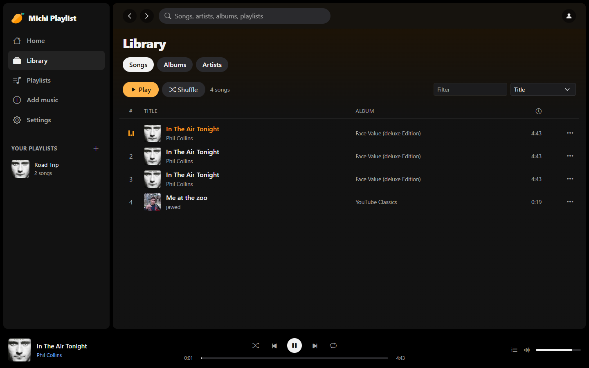
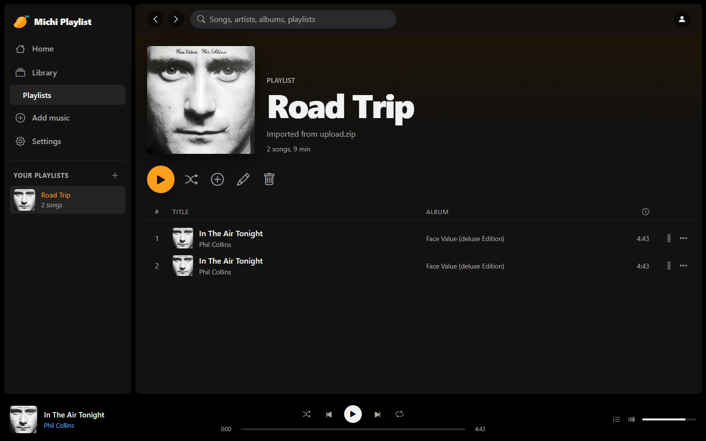
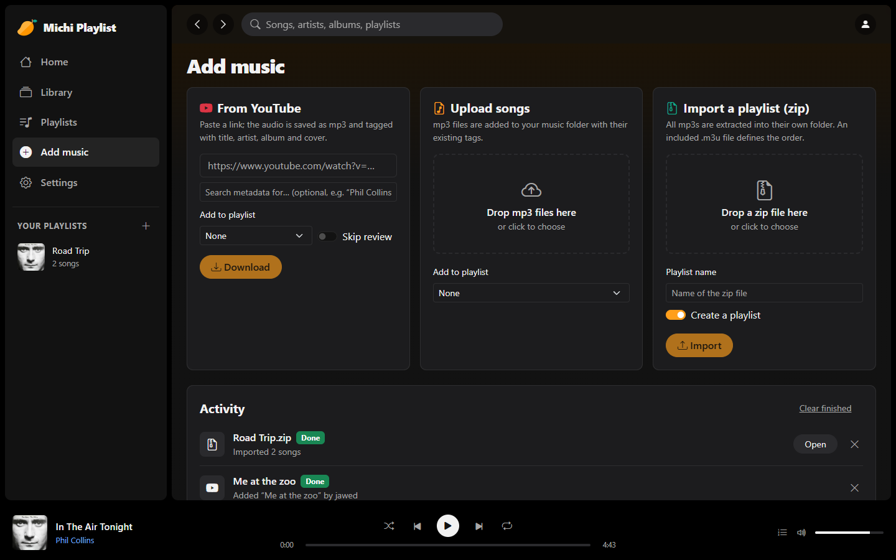
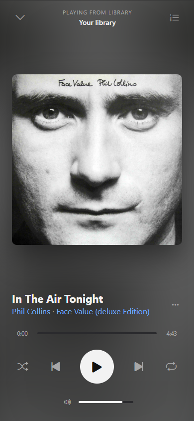

# Michi-Playlist
A vibe coded playlist player i did in under 2h for a colleage that wanted a simple music player for his mp3 collection. It was a fun project and i learned ~a lot~ nothing.

A private, self-hosted web music player for your own mp3 collection, styled
like Spotify or Apple Music. Version 2 is a complete rewrite: a Django REST
API, a React + Bootstrap frontend and a hardened Docker Compose setup.



## Features

- **Library**: songs, albums and artists from the ID3 tags of your mp3 files,
  including cover art. The music folder is rescanned automatically (default:
  every 5 minutes), so new files you copy in show up by themselves.
- **Player**: the play bar stays visible on every page. It has play/pause,
  next/previous, seeking, volume, shuffle, repeat (all/one) and an editable
  queue ("play next", "add to queue"). Lock screen and headset controls work
  via the Media Session API, and the queue survives a page reload.
- **Home**: recently played songs and playlists, recently added songs, albums.
- **Search**: across songs, artists, albums and playlists.
- **Playlists**: create, rename, delete, add/remove songs and reorder them by
  drag & drop.
- **Add music**:
  - paste a **YouTube link**: the audio is downloaded as mp3, matching tags and
    cover are looked up (iTunes Search API), and you review and adjust them
    before the song is saved,
  - **upload mp3 files** by drag & drop,
  - **upload a zip** to import a whole playlist (an included `.m3u` file
    defines the order).
- **Manage**: edit tags and covers (also with an online lookup), or delete
  songs. Changes are written into the mp3 files, which stay the source of truth.
- **Settings**: library statistics, "scan now", a one-click **yt-dlp update**
  (no image rebuild needed when YouTube changes), dark/light theme, password
  change.
- **Responsive**: a sidebar layout on desktop. On phones there is a bottom
  navigation, a mini player and a full-screen "Now Playing" view.

| Playlist | Add music | Mobile |
| --- | --- | --- |
|  |  |  |

## Architecture

```
                     127.0.0.1:4000
                          │
                 ┌────────▼────────┐  serves the React app
                 │  proxy (nginx)  │  /api, /admin, /static ──► api
                 └────────┬────────┘  streams mp3/covers after Django
          network "edge"  │           authorised them (X-Accel-Redirect)
                 ┌────────▼────────┐        ┌──────────────────────┐
                 │ api (Django +   │        │ worker               │
                 │ gunicorn)       │        │ YouTube downloads,   │
                 └────────┬────────┘        │ zip imports, scans   │
       network "internal" │ (no internet)   └──────────┬───────────┘
                 ┌────────▼────────┐                   │
                 │ db (PostgreSQL) │◄──────────────────┘
                 └─────────────────┘
```

| Path | Content |
| --- | --- |
| `backend/` | Django project: `library` (songs, playlists, scanner, imports), `jobs` (background job queue + worker), `core` (auth, system info) |
| `frontend/` | React 19 + TypeScript + Vite, Bootstrap 5.3 / react-bootstrap, TanStack Query, zustand |
| `docker/` | nginx config and container entrypoint |
| `music/` | default music folder (mp3 files, any sub-folders) |

## Install / run

Requirements: Docker with Docker Compose.

```bash
cp .env.example .env      # then edit: APP_PASSWORD, POSTGRES_PASSWORD, MUSIC_DIR
docker compose up -d --build
```

Open <http://localhost:4000> and log in with `APP_USERNAME` / `APP_PASSWORD`.
The user is created on the first start; change the password later on the
Settings page.

### Using the music of the old version

Point `MUSIC_DIR` in `.env` to the old audio folder (for example
`MUSIC_DIR=./html/michi-playlist/audio`). The folder is scanned on startup.
The old text playlists can be imported too. Copy them into a hidden folder
inside the music folder (hidden folders are not scanned), import, then remove it:

```bash
cp -r ./html/michi-playlist/playlists "$MUSIC_DIR/.old-playlists"
docker compose exec api python manage.py import_legacy_playlists /music/.old-playlists
rm -r "$MUSIC_DIR/.old-playlists"
```

Songs are matched by file name. `playlist.txt` (the old "all songs" list) is
skipped unless you add `--include-all`.

### Updating

```bash
git pull
docker compose up -d --build
```

Database migrations run automatically when the `api` container starts.

## Security

The player is meant to stay private:

- Only the nginx proxy publishes a port, and by default only on
  `127.0.0.1` (`BIND_ADDRESS`), so other machines cannot reach it. To use it
  in your LAN or through a reverse proxy with HTTPS, set `BIND_ADDRESS`,
  `ALLOWED_HOSTS` and, for HTTPS, `CSRF_TRUSTED_ORIGINS` and
  `SECURE_COOKIES=true`.
- PostgreSQL is on an internal Docker network without internet access and is
  not reachable from the proxy.
- Every API call, audio stream and cover needs a login (Django session +
  CSRF protection, login rate limiting). nginx only serves the files after
  Django has checked the session.
- All containers run as non-root with read-only file systems, all Linux
  capabilities dropped and `no-new-privileges`.
- Uploads are validated: only real mp3 files are accepted, zip archives are
  extracted with size limits and without paths (no zip-slip). YouTube links
  and cover image URLs are restricted to known hosts.
- A strict Content Security Policy and other security headers are set.

## Mobile app (Android / iPhone)

`mobile/` contains a native app (Expo / React Native) with streaming,
background playback with lock-screen controls, and **offline downloads**:

- Download songs, albums or whole playlists; downloaded playlists follow
  changes on the server (new songs are downloaded, removed ones deleted).
- Every song shows where it comes from: grey cloud = streamed, orange arrow =
  on the phone. Songs changed on the server (new tags, cover or audio) are
  marked and can be updated ("Update all" on the Downloads tab, or
  "Re-download" on a song).
- Without connection the app switches to an offline mode with the downloaded
  music; plays are uploaded when the server is reachable again.

**Connecting through WireGuard.** The phone reaches the server through your
VPN, so the player never has to be exposed to the internet:

1. In `.env`, set `BIND_ADDRESS` to the server's WireGuard IP (e.g. `10.8.0.1`)
   and add it to `ALLOWED_HOSTS`; then `docker compose up -d`.
2. In the app, log in with `10.8.0.1:4000` and your user. WireGuard encrypts
   the traffic, so plain HTTP inside the tunnel is fine.

Each phone gets its own login token; see and revoke them in the web player
under *Settings → Connected apps*. Audio is streamed through short-lived
signed links (per song, 24 h), so the token never appears in URLs or logs.

**Releases (GitHub Actions).** Pushing a tag like `app-v1.2.0` builds the app on
GitHub and publishes a release with both files
([workflow](.github/workflows/mobile-release.yml)):

- `MichiPlaylist-1.2.0.apk` – install directly on Android.
- `MichiPlaylist-1.2.0-unsigned.ipa` – install on iPhone with
  [Sideloadly](https://sideloadly.io) or [AltStore](https://altstore.io), which
  sign it with your Apple ID (free Apple IDs: refresh every 7 days).

```bash
git tag app-v1.2.0 && git push origin app-v1.2.0
```

The APK is signed with your own key from the repository secrets
`ANDROID_KEYSTORE_BASE64`, `ANDROID_KEYSTORE_PASSWORD` and `ANDROID_KEY_ALIAS`
(create one with `keytool -genkeypair -storetype PKCS12 -keystore release.jks
-alias michi -keyalg RSA -keysize 4096 -validity 10000` and store
`base64 -w0 release.jks` as the first secret). Keep a backup of the key: updates
must be signed with the same key.

**Build with EAS.** Alternatively, Expo's cloud builds work too (no Android
Studio or Xcode needed):

```bash
cd mobile
npm install
npx eas-cli@latest build -p android --profile preview   # installable APK
npx eas-cli@latest build -p ios --profile preview       # needs an Apple developer account
```

For development, `npx expo start` and the Expo Go app work too (without
lock-screen controls, which need a real build).

## Configuration

All settings live in `.env` (see [.env.example](.env.example)):

| Variable | Default | Meaning |
| --- | --- | --- |
| `APP_USERNAME` / `APP_PASSWORD` | `admin` / – | Initial login |
| `POSTGRES_PASSWORD` | – | Database password |
| `MUSIC_DIR` | `./music` | Folder with your mp3 files |
| `BIND_ADDRESS` / `HTTP_PORT` | `127.0.0.1` / `4000` | Where the player is reachable |
| `ALLOWED_HOSTS` | `localhost,127.0.0.1` | Host names used to open the player |
| `CSRF_TRUSTED_ORIGINS` | – | e.g. `https://music.example.com` behind an HTTPS proxy |
| `SECURE_COOKIES` | `false` | `true` when served via HTTPS only |
| `APP_UID` / `APP_GID` | `1000` | Owner of the music folder (`id` on the host) |
| `LIBRARY_SCAN_INTERVAL` | `300` | Seconds between automatic folder scans (`0` = off) |

## Development

Backend (Python 3.12+):

```bash
cd backend
python -m venv .venv && .venv/bin/pip install -r requirements.txt   # Windows: .venv\Scripts\
.venv/bin/python manage.py migrate
APP_PASSWORD=dev .venv/bin/python manage.py ensure_admin
DJANGO_DEBUG=1 .venv/bin/python manage.py runserver      # API on :8000
.venv/bin/python manage.py run_worker                    # second terminal
.venv/bin/python manage.py test                          # test suite
```

Without `POSTGRES_HOST` the backend uses SQLite in `backend/var/`, and the music
folder defaults to `./music` in the repository.

Frontend (Node 24):

```bash
cd frontend
npm install
npm run dev        # http://localhost:5173, proxies /api to :8000
npm run build      # type-check + production build
```

## Edit tags manually

Tags can be edited in the web UI ("Edit info" on any song). On the command
line, e.g. with `id3v2`:

```bash
id3v2 -t "New Song Title" -a "The New Artist" -A "Awesome Album" -y 2024 -T 5 my_song.mp3
```

The library scan picks up the change automatically.

## Known issues

- **Phone in standby**: some mobile operating systems stop background web
  pages after a while to save battery, which can interrupt playback with the
  screen off. Installing the page to the home screen (it is a web app) helps
  on some devices.
